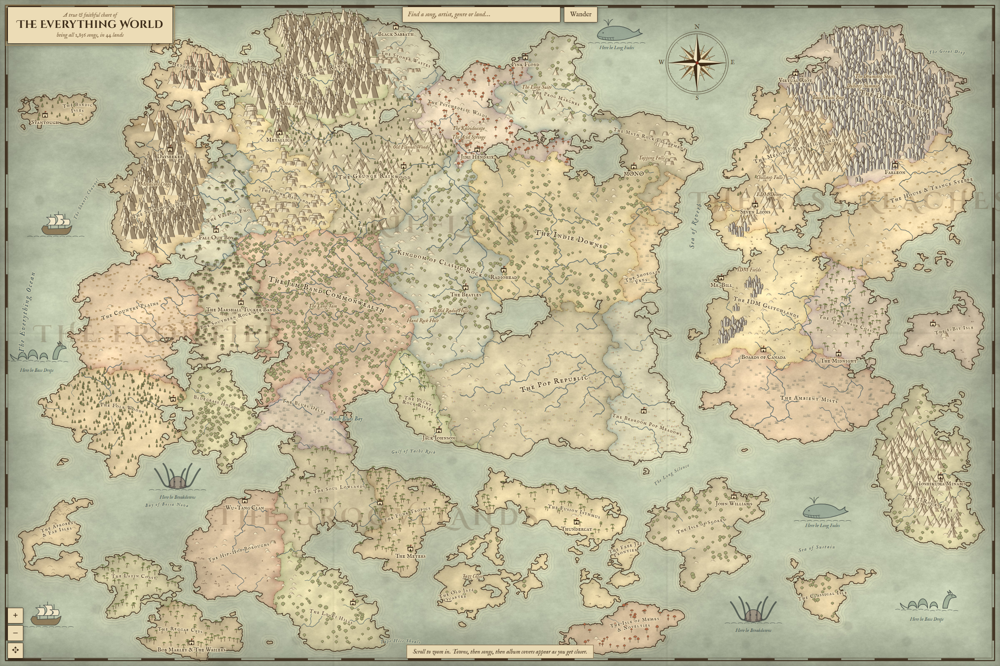

# The Everything World

### 🗺️ [Explore the map: lethalnoah.github.io/everything-world](https://lethalnoah.github.io/everything-world/)

A Spotify playlist of 1,856 songs, charted as a zoomable fantasy map on old parchment. Every song is a place you can visit, in one of 44 lands with names like the Jam Band Commonwealth, the Iron Range and the Vale of Emo.

[](https://lethalnoah.github.io/everything-world/)

## How to explore

- **Zoom in** with the scroll wheel or a pinch. Towns appear first, then songs, then album covers.
- **Click** a song, town or land for details. Songs include a Spotify player and their nearest neighbours on the map.
- **Search** for any song, artist, genre or land. Press `/` to jump to the search box.
- **Wander** flies you to a random song.

## How the music shapes the map

- **Land size** grows with song count.
- **Neighbours are similar music.** Metal borders metalcore, Southern Rock sits between Classic Rock and Country, and the Blues Delta is the land bridge to Soul.
- **Mountains come from loud songs.** Local song energy raises the terrain, and local acousticness thickens the plant cover.
- **Symbols come from each land's character:** mushrooms in the Psychedelic Wilds, willows in the Vale of Emo, crystals in the Dubstep Shards.
- **Towns are artists** with 3 or more songs. The castle marks the artist with the most songs in that land.
- **Named places are genres.** Every genre in the playlist has a feature, such as Riddim Ridge, Hairspray Heights or Lo-Fi Lagoon.

Genre tags and audio features came from a playlist export. Artists with no tags, and a few with misleading ones, were placed by hand, so some of the geography is a matter of opinion.

## Running it yourself

The site is plain HTML, CSS and JavaScript with no build step. Download the repo and double-click `index.html`.

## Charting your own playlist

The scripts in `build/` generate the world. They need Python with numpy, scipy, pillow and contourpy.

1. Export a playlist as CSV with [Exportify](https://exportify.net) and save it as `build/playlist.csv`. The original export isn't included here.
2. From the `build` folder, run these in order:

```bash
python fetch_covers.py
```

```bash
python classify.py
```

```bash
python geo.py
```

```bash
python worldgen.py
```

`classify.py` lists any artist it can't place. Add those to `build/taxonomy.py`. Land positions, names and terrain recipes are in `build/layout.py`, and those will need adapting to your own music. `geo.py` takes an optional seed number for a different coastline.

## Credits

Album covers belong to their respective artists and labels, and are shown here to identify the music. Map fonts are [IM Fell English](https://fonts.google.com/specimen/IM+Fell+English) and [Cinzel Decorative](https://fonts.google.com/specimen/Cinzel+Decorative), both under the SIL Open Font License. Not affiliated with Spotify.
